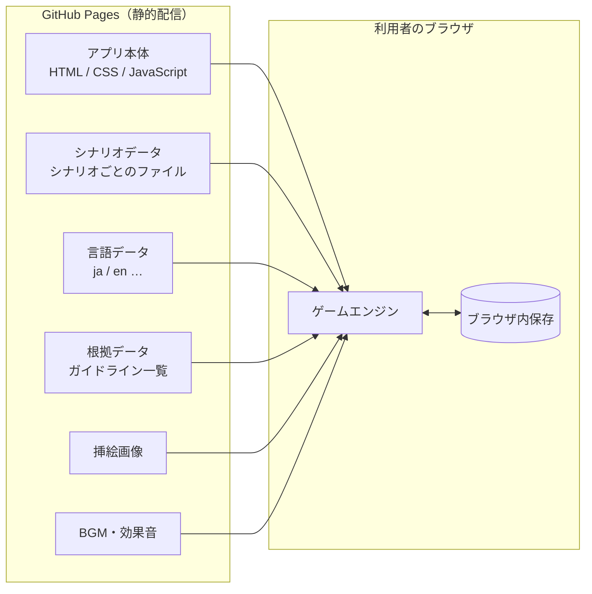
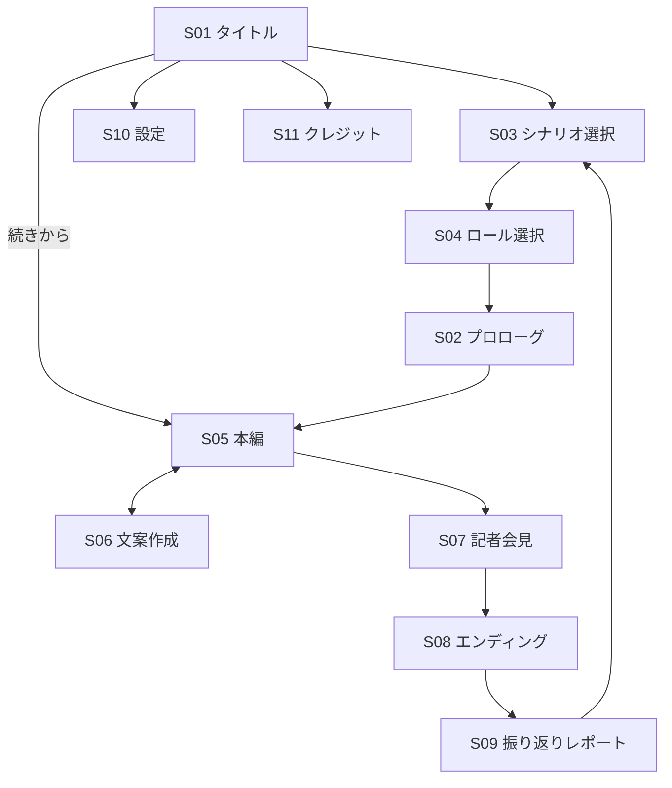
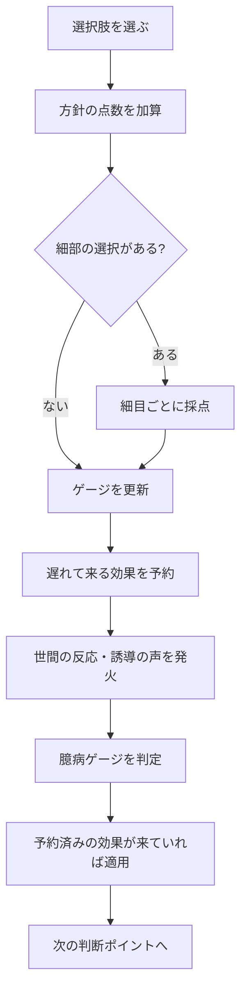

# 概要設計書

インシデントシミュレーター「じゃ、あなたがやってみてよ」（You Think You Can Do Better?）

- 版：0.1（初版ドラフト）
- 作成日：2026-11-08
- 作成：いつもの匠
- 前提文書：[要件定義書](requirements-ja.md)

本書は要件定義書を受けて、システムの全体構成、画面、データ構造、処理の流れを決める。プログラムの詳細（クラス設計、関数の仕様、使うライブラリ）は詳細設計で決める。

---

## 1. 設計方針

| 方針 | 内容 |
| --- | --- |
| 静的サイトで完結する | GitHub Pages に置くだけで動く。サーバー側の処理、データベース、外部APIは使わない |
| エンジンとシナリオを分ける | ゲームの進め方（エンジン）と、事件の中身（シナリオデータ）を完全に分ける。シナリオはデータファイルを足すだけで増やせる |
| 文言とロジックを分ける | 画面の文言とシナリオ本文は言語ごとのデータに持つ。ロジックに日本語や英語を直接書かない |
| 採点を説明できる | すべての点数に、理由と根拠（ガイドラインの項目）を持たせる。根拠のない点数はデータとして登録できないようにする |
| 初回を一番評価する | 「n回目」を必ず表示し、公式スコアに回数の係数を掛ける。代表の成績は初回記録 |
| 個人の入力を外に出さない | プレイヤーの入力（最初に書く批判コメントなど）と点数は、ブラウザの中だけで扱う |
| テキストが主役 | 挿絵がなくても成立する。挿絵は任意の場面に差し込める「スロット」として扱う |
| 音と演出で没頭させる | BGM・効果音・画面演出を必ず入れる。ただし正誤を先に知らせる音や演出は出さない |

---

## 2. システム構成



### 2.1 構成要素

| 要素 | 役割 |
| --- | --- |
| アプリ本体 | 画面の表示、操作の受け付け |
| ゲームエンジン | シナリオの読み込み、進行、ゲームの時計、採点、ゲージ、ミスリードの発火、エンディング判定 |
| シナリオデータ | 1シナリオ＝1まとまりのデータ。発端、フェーズ、ロール別の判断ポイント、細目、反応、皮肉、エンディングを持つ |
| 言語データ | 画面の共通文言。シナリオ本文はシナリオデータ側に言語ごとに持つ |
| 根拠データ | ガイドラインの一覧（文書名、版、項目）。細目はここを参照する |
| 挿絵画像 | 挿絵スロットに表示する画像。なくても動く |
| BGM・効果音 | 場面と炎上度で切り替わるBGM、出来事に合わせた効果音。すべてフリー素材を使い、出典と利用条件は一覧ファイルで管理する |
| 演出 | 通知の雪崩、揺れ、暗転、早送り、フラッシュなどの画面演出 |
| ブラウザ内保存 | 進行状況、点数、プロローグの入力、クリア状況、言語設定 |

### 2.2 フォルダ構成（案）

```
/                      アプリ本体
/scenarios/<id>/       シナリオごとのデータと挿絵
/locales/<lang>/       画面の共通文言
/references/           根拠データ（ガイドライン一覧）
/audio/                BGM・効果音と素材の一覧
/docs/                 設計文書
```

### 2.3 技術選定

| 項目 | 採用 | 理由 |
| --- | --- | --- |
| 言語 | TypeScript | 採点やゲージの計算ミスを型で防ぐ。シナリオデータの型もそのまま使える |
| UIフレームワーク | Svelte | テキスト主体の画面を少ないコードで書ける。出力が小さく、静的サイトに向く |
| ビルド | Vite | 静的ファイルとして書き出し、GitHub Pages に置くだけで動く |
| シナリオデータ | YAML | 人が読み書きしやすく、コメントを書ける。シナリオライターが直接編集する |
| データ検査 | ビルド時にスキーマで検査 | YAML をビルド時に読み込んで検査し、配信用のデータに変換する。検査に通らないシナリオはビルドが失敗する（テスト計画書の C01〜C16 をここで実行する） |
| 単体テスト | Vitest | Vite と同じ設定で動く |
| 画面テスト | Playwright | PC とスマホ幅、日本語と英語をまとめて自動で確かめる |
| 公開 | GitHub Actions で GitHub Pages に配信 | main に入ったら、検査・テスト・ビルド・配信を自動で行う |

YAML は利用者のブラウザでは読み込まない。ビルド時に検査と変換を済ませるため、壊れたシナリオが公開されない。

条件は変わらない。「GitHub Pages で配信できること」「シナリオ追加にプログラムの変更が要らないこと」。

---

## 3. 画面設計

### 3.1 画面一覧

| ID | 画面 | 主な内容 |
| --- | --- | --- |
| S01 | タイトル | 製品名、言語切替、続きから／はじめから、目的、免責表示（高得点でも現実の対応が正しいとは限らない）、「悪いのは攻撃した犯罪者」の注記 |
| S02 | プロローグ | 「この事件が報じられたとき、あなたは何と書き込みましたか」の自由入力、「公表まで何時間かかると思いますか」の予想 |
| S03 | シナリオ選択 | 10シナリオの一覧。区分（最新・定番・引退）、難しさ、元事件の時期、クリア状況（代表は初回記録、2回目以降の最高は「最高（n回目）」として併記） |
| S04 | ロール選択 | 4ロールの説明、見える情報と権限、所要時間の目安 |
| S05 | 本編 | ゲームの時計、ゲージ、状況テキスト、挿絵スロット、選択肢、世間の反応、社内チャット |
| S06 | 文案作成 | 公表文や報告を、文の部品を選んで組み立てる（細目採点の対象） |
| S07 | 記者会見 | 連続する質問への回答（終盤の山場）。1問ごとに制限時間あり |
| S08 | エンディング | 「n回目」、ランク、公式スコア（素点×回数係数）、半年後の売上見通し、プロローグの入力と実際の対応の対比、「高得点でも現実の対応が正しいとは限らない」注記 |
| S09 | 振り返りレポート | 「n回目」、素点と公式スコア、判断ごとの点、取れた細目と取りこぼした細目、根拠、「あなたを動かした声」一覧、注記。印刷・保存できる（印刷にも「n回目」と注記が必ず入る） |
| S10 | 設定 | 言語、文字サイズ、BGM音量、効果音音量、ミュート、演出を減らす、記者会見の時間延長、保存データの消去 |
| S11 | クレジット | いつもの匠、音・挿絵素材のクレジット |

### 3.2 画面の流れ



### 3.3 本編画面（S05）の配置

| 区画 | 内容 |
| --- | --- |
| 上部バー | 「n回目」の表示、ゲームの時計（Day と時刻、15分刻み）、法定期限までの残り時間、4ゲージ（被害拡大・炎上度・信頼・体力）と臆病ゲージ |
| 状況 | 今起きていること、届いた報告、挿絵スロット |
| 選択 | 方針の選択肢（大きな選択）→ 必要に応じて実行の細部（細かい選択） |
| 世間の声 | 架空SNS、ニュース、掲示板、社内チャットのタイムライン。誘導の声と正しい声を同じ見た目で流す |
| 記録 | プレイヤーが残した記録（時刻と判断の理由）。記者会見で使える |

スマートフォンでは区画を縦に並べ、世間の声と記録はタブで切り替える。

---

## 4. データ設計

### 4.1 シナリオデータの構造

1つのシナリオは、次の要素を持つ。

| 要素 | 内容 |
| --- | --- |
| メタ情報 | ID、版、公開日、区分（最新・定番・引退）、元事件の時期（例：2026年秋）、難しさ、対応言語、参照したガイドラインの版 |
| 会社設定 | 架空の会社名、業種、規模、グループ構成、登場人物（すべて架空） |
| 発端 | 最初の出来事、開始時刻 |
| フェーズ | 7フェーズ（検知、初動・封じ込め、体制と報告、調査、通知・公表、復旧、事後対応） |
| ロール別の判断ポイント | ロールごとに15〜25個（経営者ロールは15〜18個）。発生する時刻・条件、状況テキスト、選択肢 |
| 選択肢 | 文言、所要時間、ゲージへの影響、点数区分と点数、遅れて来る効果、細部の選択への分岐 |
| 細目 | 採点項目。点数（±1〜20）、6つの軸のどれか、根拠への参照 |
| 世間の反応 | 誘導の声か正しい声か、ミスリードの型（12種）、発火の条件、表示する媒体 |
| 皮肉 | シュールな演出。発火の条件 |
| 記者会見 | 質問、回答の選択肢、記録を持っているときだけ使える回答 |
| エンディング | ランクごとの文章、半年後の売上見通しの計算式 |
| 挿絵スロット | 置く場面、画像、代替テキスト |
| 文言 | 上記すべての文章を言語ごとに持つ |

### 4.2 根拠データ

| 項目 | 内容 |
| --- | --- |
| 根拠ID | 細目から参照するための識別子 |
| 文書名・発行元・版 | 例：個人情報保護法の漏えい等報告、サイバーセキュリティ経営ガイドライン |
| 項目 | 該当する章や要件 |
| 要約 | 振り返りレポートに出す一文 |
| 確認日 | 最後に一次資料で確認した日 |

法令やガイドラインが改訂されたら、根拠データを直す。その根拠を参照している細目を、すべてのシナリオから洗い出せるようにする。

### 4.3 ブラウザ内に保存するデータ

| データ | 内容 | 消すタイミング |
| --- | --- | --- |
| 設定 | 言語、文字サイズ | 利用者が消去したとき |
| 進行中のプレイ | シナリオID・版、ロール、ゲームの時計、ゲージ、点数、選択の履歴、記録 | プレイを終えたとき、利用者が消去したとき |
| プロローグの入力 | 批判コメント、公表時間の予想 | 利用者が消去したとき |
| プレイ回数 | シナリオ×ロールごとの回数 | 利用者が消去したとき（消去前に「プレイ回数と初回記録も消えます」と確認） |
| クリア状況 | シナリオ×ロールごとの初回記録（ランクと公式スコア）、2回目以降の最高、全視点リプレイの解放 | 利用者が消去したとき |

- 保存先はブラウザの機能だけを使う。サーバー、解析ツール、外部サービスには送らない
- シナリオの版が上がって途中のデータと合わなくなったら、「古い版の続き」として遊べるか、はじめからやり直すかを選ばせる
- ブラウザの保存が使えない環境（プライベートブラウズなど）でも、保存なしで最後まで遊べる

---

## 5. 処理設計

### 5.1 ゲームの時計

- 単位は15分。行動ごとに所要時間を消費する
- 法定期限（個人情報保護委員会への速報・確報など）は、時計と連動した期限として管理する
- 一定の時刻になると、外から出来事が起きる（報道、攻撃者の要求、取引先からの問い合わせ）

### 5.2 採点の流れ



| 項目 | 設計 |
| --- | --- |
| 点数区分 | 信頼を増やす（+200〜+500）、回復させる（+50〜+150）、維持する（+10〜+30）、傷つける（−30〜−150）、壊す（−200〜−300） |
| 細目 | ±1〜20。方針の点数とは別に積み上げる |
| 致命的な失点 | 1つでも取ると、それ以降は「信頼を増やす」の加点が解放されない（低い代わりの点になる） |
| 遅れて来る効果 | 誘導に乗った選択は、その場の炎上度を下げ、数フェーズ後に減点を適用する |
| 臆病ゲージ | 「保留」「様子見」「確定してから」の連続回数で、−10、−20、−40と増える |
| 便乗商法 | 被害者対応より先に事件を宣伝に使うと、「信頼を傷つける」で減点 |
| 回数係数 | 公式スコア＝素点×係数。1回目×1.2、2回目×1.0、3回目×0.8、4回目以降×0.6。素点がマイナスのときは係数を掛けない |
| エンディング | 公式スコアで判定。S：+1200以上かつ致命的な失点なし、A：+600以上、B：+200以上、C：0〜+199、D：マイナス |

### 5.3 ミスリードの発火

- 判断ポイントの半分以上に、誤った対応を勧める声を1つ以上出す（シナリオデータ側で保証する）
- 誘導の声と正しい声は、同じ表示形式で、区別できる印を付けない
- 「他のプレイヤーの多くが選んだ選択肢」は、初版ではシナリオデータに書いた架空の割合を出す
- 振り返りでは、プレイヤーが選んだ選択肢と、その直前に出ていた誘導の声を結び付けて「あなたを動かした声」として出す

### 5.4 記者会見の制限時間

| 項目 | 設計 |
| --- | --- |
| 制限時間 | 1問ごとに現実の時間で数える。標準は30秒。難しい質問はシナリオ側で20〜45秒に変えられる |
| 時間切れ | 「確認しておりません」と答えたものとして扱い、−30点。炎上度が上がる |
| 記録の参照 | 回答中に、プレイヤーが残した記録を開ける。ただし開いている間も時間は減る |
| 質問の数 | 5〜8問。記録や公表の内容によって、厳しい質問が追加される |
| 時間の延長 | 設定で1.5倍・2倍に延ばせる（アクセシビリティのため）。延長しても点数は変えず、振り返りレポートに延長したことを表示する |

ゲームの時計（15分刻み）とは別に、現実の時間を数えるのは記者会見だけとする。

### 5.5 振り返りレポート

- 冒頭に「n回目」、素点、回数係数、公式スコアを出す
- 判断ごとに、選んだもの、点数、根拠、取れた細目、取りこぼした細目を並べる
- 取りこぼした細目は「あと何をしていれば何点だったか」の形で出す
- プロローグの入力と実際の公表時刻を並べて出す
- 印刷用の表示を用意し、ブラウザの印刷機能でPDFに保存できるようにする

---

## 6. 多言語対応

- 初版は日本語（ja）と英語（en）
- 画面の共通文言は言語データに、シナリオ本文はシナリオデータに、言語ごとに持つ
- 文言がその言語にないときは、日本語にせず「未翻訳」と分かる表示にする（テストで検出する）
- 法令・報告先・期限は国によって違うため、「法制度パック」として切り替えられる構造にしておく。初版は日本の法制度パックだけ
- 皮肉は直訳せず、言語ごとに書き直す

---

## 7. シナリオの追加・差し替え


- シナリオは、所定のフォルダにデータを置き、シナリオ一覧に登録するだけで追加できる
- 公開の前に自動検査を通す（テスト計画書の「シナリオ内容の検査」）
- 元事件の公式な続報が出揃ってから公開する

---

## 8. 非機能

| 項目 | 方針 |
| --- | --- |
| プレイ時間 | 1シナリオ×1ロールで30〜60分。経営者ロールは30分前後（判断ポイントは15〜18に抑え、細目は文案作成と記者会見に寄せる）。4ロールすべてで1シナリオあたり2〜4時間。途中保存できるため、分けて遊べる |
| 対応ブラウザ | PC とスマートフォンの主要ブラウザの最新版 |
| 表示速度 | 1シナリオ分のデータだけを読み込む。挿絵は遅れて読み込む |
| アクセシビリティ | キーボードだけで操作できる。挿絵には代替テキスト。色だけで意味を伝えない（ゲージには数値も出す）。音で伝えることは文字でも出す。点滅は1秒に3回以下 |
| 演出とサウンド | BGMと効果音を必ず入れる。正誤を先に知らせない。自動再生の制限に合わせ、最初の操作の後に鳴らす。音量・ミュート・演出を減らす設定を用意する |
| セキュリティ | 外部へ通信しない。プレイヤーの入力を画面に表示するときは、そのまま HTML として解釈しない。外部のスクリプトを読み込まない |
| プライバシー | 解析ツール・広告は入れない。保存はブラウザ内だけ |
| クレジット | 画面の下部とレポートに「いつもの匠」を表示する |
| 注記 | 「高得点でも現実の対応が正しいとは限らない」注記を、スコアを出すすべての画面（エンディング、振り返りレポート、シナリオ一覧のクリア状況）に出す。「悪いのは攻撃した犯罪者」の注記を、タイトル、各シナリオの冒頭、攻撃者の場面、全エンディング、振り返りレポートに出す。注記の文言はシナリオではなく共通の言語データに持ち、シナリオ側で消せないようにする |

---

## 9. 今後決めること（詳細設計で扱う）

- シナリオYAMLのスキーマの詳細（キー名、必須・任意）
- 文案作成画面（S06）の操作方法
- 記者会見の質問ごとの制限時間の決め方

詳細は[詳細設計書](detailed-design-ja.md)で扱う。
