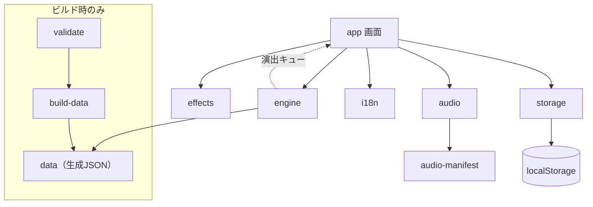
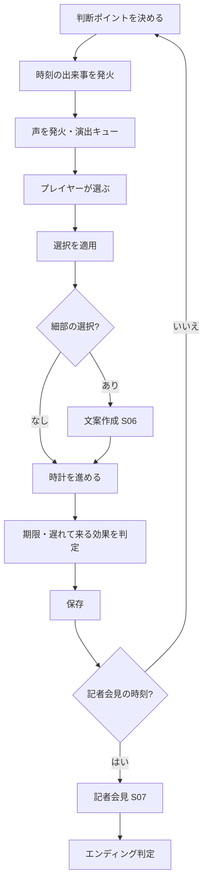

# 詳細設計書

インシデントシミュレーター「じゃ、あなたがやってみてよ」（You Think You Can Do Better?）

- 版：0.1（初版ドラフト）
- 作成日：2026-11-08
- 作成：いつもの匠
- 前提文書：[要件定義書](requirements-ja.md)、[概要設計書](basic-design-ja.md)、[テスト計画書](test-plan-ja.md)

本書は、概要設計書で決めた構成を、実装できる粒度まで具体化する。型やデータ構造は TypeScript と YAML の記法で書くが、これは設計の表記であり、実装そのものではない。

---

## 1. 前提と方針

| 項目 | 内容 |
| --- | --- |
| 技術 | TypeScript、Svelte、Vite。GitHub Actions で GitHub Pages に配信 |
| シナリオ | YAML。ビルド時に検査して JSON に変換する。ブラウザは YAML を読まない |
| 保存 | ブラウザの localStorage だけ。サーバー送信なし |
| 演出 | BGM・効果音・画面演出を必ず入れる。ただし正誤を音や演出で先に知らせない |
| 注記 | 「悪いのは攻撃した犯罪者」「高得点でも現実の対応が正しいとは限らない」は共通の言語データに置き、シナリオから消せない |
| 決定性 | 同じシナリオ・同じ選択なら、必ず同じ結果になる（乱数を使わない）。採点の再現とテストのため |

---

## 2. ディレクトリ構成

```
/
├─ index.html
├─ package.json
├─ vite.config.ts
├─ src/
│  ├─ main.ts                 起動、言語・設定の読み込み
│  ├─ app/                    画面（Svelte コンポーネント）
│  │  ├─ screens/             S01〜S10
│  │  ├─ parts/               上部バー、ゲージ、タイムライン、選択肢、記録、挿絵スロット
│  │  └─ effects/             画面演出（通知の雪崩、揺れ、暗転、フラッシュ）
│  ├─ engine/                 ゲームエンジン（画面に依存しない純粋な処理）
│  │  ├─ state.ts             ゲームの状態
│  │  ├─ clock.ts             ゲームの時計と期限
│  │  ├─ events.ts            時刻・条件で起きる出来事
│  │  ├─ choices.ts           選択の適用
│  │  ├─ scoring.ts           方針点、細目、致命的フラグ、公式スコア、ランク
│  │  ├─ gauges.ts            4ゲージと臆病ゲージ
│  │  ├─ delayed.ts           遅れて来る効果の予約と適用
│  │  ├─ voices.ts            世間の声とミスリードの発火
│  │  ├─ press.ts             記者会見と制限時間
│  │  ├─ ending.ts            エンディング判定、売上見通し
│  │  └─ report.ts            振り返りレポートの組み立て
│  ├─ audio/                  BGM・効果音の再生と切り替え
│  ├─ storage/                保存と移行
│  ├─ i18n/                   言語切替、文言の取得
│  └─ data/                   ビルドで生成された JSON（手で編集しない）
├─ scenarios/<id>/
│  ├─ scenario.yaml           シナリオ本体
│  └─ images/                 挿絵
├─ references/references.yaml 根拠データ
├─ locales/<lang>/ui.yaml     画面の共通文言と固定の注記
├─ audio/
│  ├─ bgm/                    BGM
│  ├─ se/                     効果音
│  └─ audio-manifest.yaml     素材ごとの出典・利用条件・クレジット
├─ tools/
│  ├─ validate/               シナリオ検査（C01〜C21）
│  └─ build-data/             YAML → JSON 変換
├─ tests/
│  ├─ unit/                   Vitest
│  └─ e2e/                    Playwright
└─ docs/
```

`engine/` は画面・音・保存に依存しない。画面は `engine` の関数を呼び、返ってきた新しい状態を表示するだけにする。こうすると、採点の単体テストを画面なしで書ける。

---

## 3. モジュール構成



- エンジンは、状態を変えるたびに「演出キュー」（鳴らす音、出す演出の一覧）を返す。画面はそれを受け取って音と演出を実行する。エンジン自身は音を鳴らさない
- 演出キューには、正誤を示す情報を入れない（10章）

---

## 4. 状態モデル

### 4.1 プレイの状態

```ts
type RoleId = 'executive' | 'officer' | 'lead' | 'analyst';

interface PlayState {
  scenarioId: string;
  scenarioVersion: string;
  role: RoleId;
  playCount: number;            // このシナリオ×ロールの何回目か（1始まり）
  clock: { day: number; minutes: number };   // Day と 0:00 からの分（15分刻み）
  phase: PhaseId;               // detect | contain | organize | investigate | notify | recover | after
  pointId: string | null;       // いま表示している判断ポイント
  gauges: { damage: number; flame: number; trust: number; stamina: number }; // 0〜100
  cowardStreak: number;         // 「保留」系を連続で選んだ回数
  rawScore: number;             // 素点
  fatal: boolean;               // 致命的な失点を取ったか
  history: ChoiceRecord[];      // 選択の履歴（振り返りに使う）
  itemsEarned: string[];        // 取れた細目ID
  itemsMissed: string[];        // 取りこぼした細目ID
  delayed: DelayedEffect[];     // 予約済みの遅れて来る効果
  voicesShown: VoiceShown[];    // 表示した声（「あなたを動かした声」に使う）
  notes: PlayerNote[];          // プレイヤーの記録
  deadlines: DeadlineState[];   // 法定期限などの状態
  flags: Record<string, boolean>; // シナリオ側の条件分岐に使う旗
  press: PressState | null;     // 記者会見中の状態
  prologue: { comment: string; predictedHours: number | null };
  startedAt: string;            // 現実の開始時刻（ISO文字列、表示用のみ）
}
```

ゲージの意味：

| ゲージ | 0 | 100 | 初期値 |
| --- | --- | --- | --- |
| damage（被害拡大） | 被害なし | 最大 | シナリオで指定（例：20） |
| flame（炎上度） | 静か | 大炎上 | 0 |
| trust（信頼） | 失墜 | 最大 | 70 |
| stamina（体力） | 限界 | 万全 | 100 |

### 4.2 選択の記録

```ts
interface ChoiceRecord {
  pointId: string;
  choiceId: string;
  at: { day: number; minutes: number };
  policyPoints: number;          // 方針点
  itemPoints: number;            // その判断で取れた細目の合計
  voicesBefore: string[];        // 選ぶ直前に表示されていた声のID
}
```

---

## 5. シナリオYAMLの仕様

### 5.1 全体

```yaml
id: no04-goride
version: 1.0.0
status: latest            # latest | standard | retired
published: 2026-12-01
sourcePeriod: { ja: 2026年秋の事件を反映, en: Based on an incident in autumn 2026 }
difficulty: 4             # 1〜5
languages: [ja, en]
referencesVersion: 2026-11-08
legalPack: jp             # 法制度パック

company:
  name: { ja: 株式会社ゴーライド, en: GoRide Inc. }
  industry: { ja: カーシェア・レンタカー, en: Car sharing and rental }
  size: { ja: 従業員1,200名、上場企業の子会社, en: 1,200 employees, subsidiary of a listed company }
  people:
    - id: ceo
      name: { ja: 架空の人物名, en: Fictional name }
      title: { ja: 代表取締役, en: CEO }

start: { day: 0, minutes: 540 }   # Day 0 9:00
initialGauges: { damage: 20, flame: 0, trust: 70, stamina: 100 }

audio:
  bgmDefault: tension_low
  bgmByPhase: { notify: tension_mid, after: calm }

roles:
  lead:
    estimateMinutes: 45
    points: [...]          # 5.2
press: {...}               # 5.6
endings: {...}             # 5.7
illustrations: [...]       # 5.8
```

- すべての文章は `{ ja: ..., en: ... }` の形で、`languages` に書いた言語をすべて持つ（検査 C14）
- 会社名・人物名は架空。国家は「某国」と表記し、実在の国名は使わない。禁止リスト（実在企業名・サービス名・人物名・国名）は `tools/validate/denylist.yaml` に持ち、当たったらビルドを止める（C16）

### 5.2 判断ポイント

```yaml
- id: lead-03-first-report
  at: { day: 0, minutes: 1080 }        # 起きる時刻。省略すると直前の判断の直後
  when: { flags: { contained: true } } # 条件（任意）
  phase: notify
  text: { ja: 法務から「第1報を今夜中に出せるか」と聞かれた。, en: ... }
  illustration: press-room-empty       # 挿絵スロット（任意）
  sound: { se: [phone_ring] }          # この場面で鳴らす音（任意）
  voices: [v-lead03-1, v-lead03-2]     # この場面で流す声（5.5）
  choices: [...]                       # 5.3
```

### 5.3 選択肢

```yaml
- id: publish-tonight
  text: { ja: 今夜中に第1報を出す, en: ... }
  minutes: 120                         # 所要時間
  category: maintain                   # increase | recover | maintain | hurt | fatal
  points: 20                           # category の範囲内（C05）
  refs: [ppc-report-prelim]            # 根拠ID（C06）
  gauges: { flame: -5, trust: +3, stamina: -10 }
  coward: false                        # true のとき臆病ゲージを数える（保留・様子見）
  setFlags: { firstReport: true }
  delayed:                             # 遅れて来る効果（任意）
    - afterPhases: 2
      points: -40
      gauges: { trust: -10 }
      reason: { ja: 隠していた範囲が報道で判明した, en: ... }
  detail: draft-first-report           # 細部の選択（文案作成）へ進む（任意）
  fatalAlternate: 5                    # increase の選択肢で、fatal 済みのときの代わりの点
```

点数区分と範囲（検査 C05）：

| category | 範囲 |
| --- | --- |
| increase（信頼を増やす） | +200〜+500 |
| recover（回復させる） | +50〜+150 |
| maintain（維持する） | +10〜+30 |
| hurt（傷つける） | −30〜−150 |
| fatal（壊す） | −200〜−300。選ぶと `fatal: true` |

### 5.4 細目（文案作成）

```yaml
drafts:
  draft-first-report:
    title: { ja: 第1報の文案, en: ... }
    slots:                               # 文の部品を選んで組み立てる
      - id: timing
        label: { ja: 出す時刻, en: ... }
        auto: true                       # 時計から自動で決まる
        items:
          - { id: t-24h, when: { withinHours: 24 }, points: 10, axis: time, refs: [ppc-report-prelim] }
          - { id: t-72h, when: { withinHours: 72 }, points: 3,  axis: time, refs: [ppc-report-prelim] }
          - { id: t-late, when: { otherwise: true }, points: -15, axis: time, refs: [ppc-report-prelim] }
      - id: scope
        label: { ja: 対象範囲, en: ... }
        options:
          - { id: s-all, text: { ja: 退会者・申込み途中の人も含む, en: ... }, points: 10, axis: content, refs: [ppc-scope] }
          - { id: s-current, text: { ja: 現会員のみ, en: ... }, points: -20, axis: content, refs: [ppc-scope],
              delayed: { afterPhases: 1, reason: { ja: 対象の訂正が必要になった, en: ... } } }
```

- `axis` は6つの軸（time / order / wording / content / record / care）のどれか
- 1つの細目は ±1〜20（C04）。細目の総数はロールごとに80以上（C03）
- 取りこぼした細目は、振り返りで「この部品を選んでいれば+10」の形で出す

### 5.5 世間の声

```yaml
voices:
  - id: v-lead03-1
    media: sns              # sns | news | board | chat | boss | vendor | attacker
    misleading: true        # 誤った対応を勧める声か（画面には出さない）
    type: law-ish           # 12種の型（C08）
    text: { ja: 「1000件未満なら報告いらないでしょ」, en: ... }
    trigger: { at: point }  # point（判断の表示時）| after（直前の選択の後）| flag 条件
  - id: v-lead03-2
    media: chat
    misleading: false
    text: { ja: 法務「件数より、不正アクセスかどうかが先です」, en: ... }
    trigger: { at: point }
```

- `misleading` と `type` は振り返りでのみ使う。プレイ中の表示には一切反映しない（同じ見た目・同じ効果音）
- 声を流すときの効果音は媒体ごとに決まり、誘導かどうかで変えない（10.3）
- 「他のプレイヤーの多くが選んだ選択肢」は、判断ポイントに `popular: { choiceId: ..., percent: 62 }` として書く（初版は架空の値）

### 5.6 記者会見

```yaml
press:
  questions:
    - id: q1
      text: { ja: 社内から事前に指摘があったというのは本当ですか, en: ... }
      seconds: 30                       # 20〜45（既定30）
      answers:
        - { id: a1, text: {...}, points: 30, requiresNote: false }
        - { id: a2, text: {...}, points: 80, requiresNote: note-warning-received }
        - { id: a3, text: {...}, points: -100 }
      timeoutPoints: -30                # 時間切れ（既定 −30）
  extraQuestions:                        # 条件で追加される厳しい質問
    - when: { flags: { hidPublication: true } }
      question: {...}
```

### 5.7 エンディング

```yaml
endings:
  S: { text: {...}, bgm: ending_s }
  A: { text: {...}, bgm: ending_a }
  B: { text: {...}, bgm: ending_b }
  C: { text: {...}, bgm: ending_c }
  D: { text: {...}, bgm: ending_d }
salesModel: { base: 100, trustWeight: 0.4, fatalPenalty: 10, min: 40, max: 130 }
```

### 5.8 挿絵

```yaml
illustrations:
  - id: press-room-empty
    file: images/press-room-empty.webp
    alt: { ja: 誰もいない会見場, en: An empty press room }
    credit: { ja: いつもの匠, en: Itsumono Takumi }
```

### 5.9 根拠データ

```yaml
- id: ppc-report-prelim
  title: { ja: 個人情報保護法 漏えい等報告（速報）, en: ... }
  issuer: { ja: 個人情報保護委員会, en: Personal Information Protection Commission }
  version: 2026-11
  section: { ja: 速報は事態を知ってから概ね3〜5日以内, en: ... }
  summary: { ja: 分かっている範囲で早く出し、不明点は調査中と書く, en: ... }
  checkedAt: 2026-11-08
  legalPack: jp
```

---

## 6. 処理の詳細

### 6.1 進行ループ



### 6.2 ゲームの時計

- 時刻は「Day」と「0:00からの分」で持つ。分は必ず15の倍数（選択肢の `minutes` も15の倍数。検査で確認）
- 時計が進むたびに、通過した時刻の出来事（`events`）を時刻順にすべて発火する
- 22:00〜6:00 は「深夜帯」として、演出（暗転）と体力の減り方（1.5倍）を変える

### 6.3 法定期限

- 期限は、シナリオ開始時に法制度パックから作る（例：速報は事態を知ってから概ね3〜5日以内で、ゲームでは3日を期限とする。確報は30日以内、不正の目的によるおそれがあるときは60日以内）。数値は根拠データの値を使い、シナリオに直接書かない（C15）
- 期限の残り時間が12時間を切ると、上部バーの表示と効果音（`deadline_warn`）で知らせる。過ぎると、シナリオで決めた減点を適用する

### 6.4 選択の適用

1. 方針点を加える。`category` が `increase` で、すでに `fatal` なら `fatalAlternate` を使う
2. `category` が `fatal` なら `fatal = true`
3. ゲージに差分を足し、0〜100 に収める
4. 体力が20未満なら、次の判断で選択肢の文言の一部をぼかす演出を入れる（判断ミスが起きやすい状態の表現。点数は変えない）
5. `coward` が true なら `cowardStreak` を1増やし、false なら0に戻す
6. 臆病ゲージ：`cowardStreak` が2・3・4以上になった時点で、それぞれ −10・−20・−40 を加え、対応する声を発火する
7. `delayed` を予約する（今のフェーズ番号＋`afterPhases`）
8. 選ぶ直前に出ていた声のIDを履歴に残す

### 6.5 遅れて来る効果

- フェーズが変わるたびに、予約された効果のうち時期が来たものを適用する
- 適用時に「なぜ今減点されたか」の短い文を世間の声として出す（例：報道で範囲が判明）
- 振り返りでは、原因になった選択と結び付けて表示する

### 6.6 公式スコアとランク

```
係数 = 1回目 1.2 / 2回目 1.0 / 3回目 0.8 / 4回目以降 0.6
公式スコア = 素点 > 0 ? 四捨五入(素点 × 係数) : 素点
ランク：
  S = 公式スコア ≥ 1200 かつ fatal = false
  A = 公式スコア ≥ 600
  B = 公式スコア ≥ 200
  C = 公式スコア ≥ 0
  D = それ以外
```

- 回数はプレイ開始時に確定する（途中で保存データを消しても、そのプレイの回数は変わらない）

### 6.7 売上見通し

```
売上見通し（事件前比 %）= 範囲内に収める( base + (最終の信頼 − 50) × trustWeight − fatal ? fatalPenalty : 0, min, max )
```

数値はシナリオの `salesModel` で調整できる。エンディングでは「半年後の売上見通し：事件前の◯％」と表示し、架空の見通しであることを添える。

### 6.8 記者会見

- 1問ずつ表示し、`seconds`（延長設定があれば1.5倍・2倍）から数え下げる
- 計時はゲームの時計とは別に、現実の時間で行う。タブが背面に回ったら止め、戻ったら再開する（不正ではなく、通知などで離れたときの不利を避けるため）
- 記録を開いている間も数え続ける
- 時間切れで `timeoutPoints` を加え、「確認しておりません」と答えた扱いにする
- `requiresNote` の回答は、その記録があるときだけ選べる

---

## 7. 画面の詳細

| 画面 | 主な要素 | 操作 | 音・演出 |
| --- | --- | --- | --- |
| S01 タイトル | 製品名、目的、注記（悪いのは犯罪者／高得点でも現実は別）、言語、続きから、はじめから、設定、クレジット | 「はじめる」で音の再生を許可 | 起動前は無音。「はじめる」でタイトルBGM |
| S02 プロローグ | 批判コメント入力（200字まで）、公表時間の予想 | 入力は任意 | 静かなBGM、タイプ音 |
| S03 シナリオ選択 | カード一覧（区分、難しさ、元事件の時期、初回記録、最高（n回目）） | 選ぶ | 選択音 |
| S04 ロール選択 | ロールの説明、見える情報、所要時間の目安、「次は n回目」 | 選ぶ | 選択音 |
| S05 本編 | 上部バー（n回目、時計、期限、ゲージ）、状況、挿絵、選択肢、世間の声、記録 | 選ぶ、記録を書く | 場面のBGM、通知・電話などの効果音、画面演出 |
| S06 文案作成 | 部品の選択欄、組み上がった文の表示 | 部品を選んで確定 | タイプ音 |
| S07 記者会見 | 質問、残り秒数、回答、記録を開くボタン | 回答を選ぶ | 会見BGM、シャッター音、フラッシュ |
| S08 エンディング | n回目、ランク、素点、係数、公式スコア、売上見通し、プロローグ対比、注記 | 振り返りへ | ランク別のBGM |
| S09 振り返り | n回目、各判断、細目（取れた／取りこぼした）、根拠、「あなたを動かした声」、注記 | 印刷 | 静かなBGM |
| S10 設定 | 言語、文字サイズ、BGM音量、効果音音量、ミュート、演出を減らす、会見の時間延長、保存データ消去 | 変更 | 音量の試聴音 |
| S11 クレジット | いつもの匠、音・挿絵素材のクレジット（audio-manifest から自動生成） | 閉じる | なし |

スマートフォン（幅 640px 未満）では、S05 の「世間の声」と「記録」をタブで切り替える。

---

## 8. 保存（localStorage）

| キー | 内容 |
| --- | --- |
| `ytcdb:v1:settings` | 言語、文字サイズ、音量、ミュート、演出を減らす、時間延長 |
| `ytcdb:v1:plays` | `{ "<scenarioId>/<role>": { count, first: { rank, score, raw, at }, best: { rank, score, count } } }` |
| `ytcdb:v1:progress` | 進行中のプレイ1件（PlayState） |
| `ytcdb:v1:prologue` | 最新のプロローグ入力 |

- 保存は、選択の確定ごと、文案の確定ごと、記者会見の各問の後に行う
- 書き込みに失敗したら（容量超過・プライベートブラウズ）、保存なしモードに切り替えて画面に一度だけ知らせる
- 版の移行：キーの `v1` を上げるときは、読み込み時に旧版を変換する。変換できないときは「はじめから」を案内する
- シナリオの版が上がっていたら、進行中のプレイは「古い版の続き」か「はじめから」を選ばせる（古い版の JSON を一定期間残す）
- 消去の前に「プレイ回数と初回記録も消えます」と確認する

---

## 9. 画面の共通文言と注記

- `locales/<lang>/ui.yaml` に画面の文言を持つ
- 次の注記は `notices` に固定で持ち、シナリオ側の文章で上書きできない（C19、C21）

| ID | 出す場所 | 文言（日本語） |
| --- | --- | --- |
| `notice.criminal` | タイトル、各シナリオ冒頭、攻撃者の場面、全エンディング、振り返り | サイバー攻撃で悪いのは、攻撃した犯罪者です。被害に遭った企業や人を責めるためのツールではありません。 |
| `notice.fiction` | 各シナリオ冒頭 | この物語はフィクションです。実在の団体・人物とは関係ありません。 |
| `notice.score` | エンディング、振り返り、クリア状況 | このシミュレーターで高得点が取れても、現実の対応が正しいとは限りません。採点は学ぶための目安です。 |
| `notice.purpose` | タイトル、README | インシデントレスポンスについて学び、興味を持ち、事件のときの批判と対応を理解できるようになるためのツールです。実在の企業を批判するものではありません。 |
| `notice.voices` | 世間の声の初回表示時、振り返り | ゲーム内の批判は、事件のときに現実に起きがちな反応を再現したもので、制作者の見解ではありません。 |
| `notice.replay` | 2回目以降のエンディング | 繰り返しで点が上がるのは当然です。現実の事件に2回目はありません。 |

---

## 10. 演出とサウンドの設計

### 10.1 方針

| 方針 | 内容 |
| --- | --- |
| 必ず入れる | BGM・効果音・画面演出は初版から入れる。テキスト主体のまま没頭できるようにする |
| 正誤を先に知らせない | 選んだ直後に正解音・不正解音・正解らしい演出を出さない。誘導の声と正しい声で音を変えない。結果が分かるのは、遅れて来る効果・記者会見・エンディング・振り返り |
| 状況を音で伝える | 鳴るのは「いま何が起きているか」（電話が鳴る、通知が増える、期限が迫る）の音だけ |
| 音だけに頼らない | 音で伝えることは、必ず画面の表示でも伝える（ミュートでも、耳が聞こえなくても遊べる） |
| 止められる | BGM・効果音の音量を別々に変えられる。ミュート、演出を減らす設定を用意する |

### 10.2 BGM

| ID | 場面 | 雰囲気 |
| --- | --- | --- |
| `title` | タイトル | 静かで不穏 |
| `prologue` | プロローグ | ほぼ無音に近い環境音 |
| `calm` | 平常、事後対応 | 落ち着いた低音 |
| `tension_low` | 検知・初動 | 時計の刻みを含む緊張 |
| `tension_mid` | 体制・調査・公表、または炎上度40以上 | テンポが上がる |
| `tension_high` | 炎上度70以上 | 切迫した、追い詰められる曲 |
| `night` | 深夜帯（22:00〜6:00） | 音数が少なく冷たい |
| `press` | 記者会見 | 張りつめた持続音 |
| `ending_s` 〜 `ending_d` | エンディング | Sは解放感、Dは重い余韻 |

**炎上度で緊張を上げる仕組み**

BGM・効果音はフリー素材を使う。フリー素材の BGM は、層ごとに分かれた音源（同じテンポ・同じ長さの複数トラック）がほとんど手に入らない。そのため、緊張の上げ方を次の3つの組み合わせにする。

| 炎上度 | 曲 | 重ねる環境音（効果音素材のループ） | 音の加工 |
| --- | --- | --- | --- |
| 0〜39 | `tension_low` | なし | なし |
| 40〜69 | `tension_mid` に切り替え | 時計の秒針、遠くの電話の着信 | なし |
| 70〜100 | `tension_high` に切り替え | ＋人のざわめき、通知音の連打 | 高音を少し削り、こもった音にする（耳が詰まったような圧迫感） |

- 曲の切り替えは 1.5秒のクロスフェード。炎上度が境目を行き来しても曲がばたつかないよう、上がるときは40・70、下がるときは35・65で切り替える
- 環境音は2秒かけて音量を上げ下げする
- 再生は Web Audio API で行う。ループ再生の継ぎ目で音が途切れないよう、素材の頭と終わりの無音を事前に切り詰める（素材の利用条件で加工が認められている場合に限る）
- `tension_high` は BGM 一覧に追加する（10.2）

### 10.3 効果音

| ID | 鳴る場面 |
| --- | --- |
| `notify_sns` | SNSの声が流れたとき（誘導かどうかに関係なく同じ音） |
| `notify_news` | ニュースが流れたとき |
| `notify_chat` | 社内チャットが来たとき |
| `phone_ring` | 電話（上司、取引先、記者、攻撃者） |
| `mail_arrive` | 攻撃者からの要求、外部からのメール |
| `clock_tick` | 時計が進むとき（早送り中） |
| `deadline_warn` | 法定期限まで12時間を切ったとき |
| `deadline_over` | 期限を過ぎたとき |
| `typing` | プロローグ入力、文案作成の文が組み上がるとき |
| `shutter` | 記者会見の質問ごと |
| `press_timer` | 記者会見の残り5秒 |
| `select` / `confirm` | 選ぶ・確定する（中立的な音。正誤で変えない） |
| `delayed_hit` | 遅れて来る効果が適用されたとき |
| `stamp` | エンディングでランクが出るとき |

- 同じ効果音が短い間に重なるときは、最大4つまでにして音量を抑える（通知の雪崩でうるさくなりすぎないようにする）

### 10.4 画面演出

| 演出 | 起きる条件 | 内容 |
| --- | --- | --- |
| 通知の雪崩 | 炎上度が一度に15以上上がった | 世間の声が短い間隔で連続して流れ込む |
| 揺れ | 炎上度70以上で新しい批判が来た | 画面全体を小さく揺らす（0.3秒） |
| 暗転 | 深夜帯 | 画面の明るさを下げ、時計を強調する |
| 早送り | 所要時間の長い選択の後 | 時計の数字が早回しで進み、`clock_tick` が鳴る |
| 期限の赤 | 期限まで12時間を切った | 上部バーの期限表示が赤くなり、点滅せずに太くなる |
| フラッシュ | 記者会見の質問ごと | カメラのフラッシュ風に一瞬白くする |
| ぼかし | 体力20未満 | 選択肢の文言の一部が薄くなる |
| タイプ表示 | 状況テキスト | 1文字ずつ表示。クリックで全文を一度に表示 |
| スタンプ | エンディング | ランクが判子のように押される |

### 10.5 配慮

- **点滅**：フラッシュを含め、明滅は1秒に3回以下にする。面積の大きい白い明滅は、明るさの変化を抑える
- **演出を減らす**：設定、または端末の「動きを減らす」設定（iPhone では「視差効果を減らす」）が有効なら、揺れ・フラッシュ・早送り・タイプ表示を止め、色や太字の変化だけにする
- **自動再生**：ブラウザは操作前の音の再生を止めるため、タイトル画面の「はじめる」を押した時点で音を有効にする。押す前は無音
- **既定の音量**：BGM 50%、効果音 70%。初回だけ「音が出ます」と表示する
- **字幕**：電話・通知などの音は、必ず画面に文字（「着信：取引先」など）でも出す
- **バイブレーション**：使わない（初版）

### 10.6 素材の管理

BGM・効果音は、すべてフリー素材を使う。フリー素材でも、利用条件はサイトごと、作者ごとに違う。1つの素材ごとに次の項目を manifest に記録し、確認した日も残す。

```yaml
# audio/audio-manifest.yaml
- id: tension_mid
  kind: bgm                     # bgm | se | ambience
  file: bgm/tension_mid.mp3
  loop: true
  title: 曲名（配布サイトの表記どおり）
  author: 作者名（配布サイトの表記どおり）
  site: 配布サイト名
  url: 素材ページのURL
  termsUrl: 利用規約のURL
  termsCheckedAt: 2026-11-08
  conditions:
    game: true                  # ゲーム・Webアプリでの利用が認められている
    free: true                  # 無料公開での利用が認められている
    modify: true                # 切り詰め・音量調整などの加工が認められている
    creditRequired: false       # クレジット表記が必須か
    creditText: ""              # 必須の場合の表記（作者指定の書式どおり）
    themeOk: true               # 本作の題材（サイバー犯罪、実在事件の架空化）が禁止用途に当たらない
    redistribution: embedded-only # 作品に組み込む形でのみ可。素材単体の再配布は不可
  notes: 作者ごとの個別条件があれば書く
```

**素材を選ぶときの確認項目**

| 確認項目 | 理由 |
| --- | --- |
| ゲーム・Webアプリでの利用が認められているか | 動画向けだけを認めるサイトもある |
| 禁止用途に本作が当たらないか | サイトによっては、政治・宗教・思想に関わる作品や、公序良俗に反する作品での利用を禁止している。本作は犯罪を扱うため、各サイトの禁止用途と照らし合わせる |
| 作者ごとの個別条件 | 同じサイトでも、作者が独自の条件を付けている場合がある |
| クレジット表記の要否と書式 | 必須の場合は、指定どおりにクレジット画面へ出す。不要な場合も、本作では出典をクレジット画面に出す |
| 加工の可否 | ループの継ぎ目を整えるための切り詰めや音量調整ができるか |
| 素材単体の再配布の扱い | フリー素材の多くは、素材そのものの再配布を禁止している。後述のリポジトリの扱いを決める根拠になる |
| AIでの生成でないか、AI学習への利用禁止 | サイトの方針を確認し、本作の側でも素材を学習用途に流用しない |

**リポジトリと素材の再配布**

GitHub の公開リポジトリに音声ファイルを置くと、誰でも素材単体をダウンロードできる状態になる。これは「素材単体の再配布」に当たるおそれがある。そのため次のように扱う。

- 音声ファイルの置き場所は、素材を採用する前に、各サイトの規約で次のどちらが許されるかを確認して決める
  1. 公開リポジトリに置いてよい（作品の一部としての公開が認められている）
  2. 公開リポジトリには置かず、配信用のビルドにだけ含める（リポジトリには manifest だけを置き、音声ファイルは非公開の保管場所から CI で取り込む）
- どちらの場合も、README に「音声素材はリポジトリのライセンスの対象外であり、各配布元の利用規約に従う。素材単体の再配布を禁止する」と書く
- 規約を確認できない素材、判断に迷う素材は使わない

- 出典・作者・クレジットは manifest からクレジット画面に自動で出す
- 形式は MP3（主要ブラウザで再生できる）。BGM は 128kbps 程度、効果音は短く軽くする
- BGM は場面に入る直前に読み込み、効果音は起動時にまとめて読み込む
- 検査：manifest にない音、manifest にあってファイルがない音、確認項目（`conditions`）が欠けている音、`game`・`free`・`themeOk` のどれかが true でない音、`creditRequired` が true なのに `creditText` が空の音、`termsCheckedAt` が1年以上前の音があればビルドを止める（C22）

---

## 11. ビルドとシナリオ検査

### 11.1 流れ

1. `tools/validate` が `scenarios/*/scenario.yaml`、`references/references.yaml`、`locales/*/ui.yaml`、`audio/audio-manifest.yaml` を読む
2. 検査（C01〜C22）を行う。1つでも失敗したら、ファイル名・行番号・理由を出してビルドを止める
3. `tools/build-data` が検査済みのデータを `src/data/*.json` に書き出す
4. Vite でアプリをビルドする

### 11.2 検査項目と実装方法

| ID | 内容 | 方法 |
| --- | --- | --- |
| C01 | 必須要素 | スキーマ検査 |
| C02 | 判断ポイント数（15〜25、経営者15〜18） | 件数を数える |
| C03 | 細目数（ロールごとに80以上） | 件数を数える |
| C04 | 細目の点数（±1〜20） | 範囲検査 |
| C05 | 点数区分の範囲 | category と points の対応表で検査 |
| C06 | 根拠の紐づけ | refs が references に存在するか |
| C07 | ミスリードの量 | misleading の声を持つ判断ポイントが半数以上か |
| C08 | ミスリードの型 | 使われた type が8種以上か |
| C09 | 臆病への批判 | coward の選択肢と、臆病ゲージの声があるか |
| C10 | 正しい対応直後の批判 | 正しい選択の after に批判の声があるか |
| C11 | 到達可能性 | 選択の組み合わせを探索し、各ランクに届く経路があるか |
| C12 | Sランクの条件 | fatal を含む経路でSに届かないか |
| C13 | 行き止まり | どの経路もエンディングに着くか |
| C14 | 文言の欠け | 全言語の文言があるか |
| C15 | 法定期限 | シナリオに期限の数値を直接書いていないか、根拠データと一致するか |
| C16 | 実名の混入 | 禁止リスト（企業名・サービス名・人物名・国名）との照合 |
| C17 | YAML の書式 | 構文エラー、型の誤り |
| C18 | 想定プレイ時間 | 文字数（日本語 500字/分）と判断数から見積もる |
| C19 | 犯罪者の注記 | 攻撃者の場面（media: attacker）とエンディングで注記の表示が有効か |
| C20 | 実在企業との比較 | 禁止表現（「〇〇社より」など）との照合 |
| C21 | 高得点の注記 | 共通文言に notice.score があり、シナリオで上書きしていないか |
| C22 | 音素材 | manifest との突き合わせ、利用条件の確認項目、クレジット、規約の確認日 |

C11〜C13 の経路探索は、判断ポイントが多いと組み合わせが爆発するため、同じ状態（フラグ・ゲージの帯・fatal）をまとめて数える方法で行う。

---

## 12. CI/CD

| きっかけ | 処理 |
| --- | --- |
| プルリクエスト | 検査（C01〜C22）、単体テスト、ビルド |
| main への反映 | 上記＋画面テスト（Playwright、PCとスマホ幅、日本語と英語）＋ GitHub Pages への配信 |

- 配信は GitHub Actions の Pages 用の手順で行う
- 失敗したら配信しない

---

## 13. エラー処理

| 状況 | 対応 |
| --- | --- |
| シナリオの読み込み失敗 | シナリオ選択に戻し、「読み込めませんでした」と出す |
| 保存の失敗 | 保存なしモードに切り替え、一度だけ知らせる |
| 音の読み込み失敗 | 音なしで続ける。設定画面に「音を読み込めませんでした」と出す |
| 文言の欠け（本番で起きた場合） | 「未翻訳」と表示する（日本語に戻さない） |
| 予期しない例外 | 進行中のプレイを保存し、エラー画面から「続きから」に戻れるようにする |

---

## 14. セキュリティとプライバシー

- 外部への通信をしない。解析ツール・広告・外部フォントの読み込みを入れない
- Content-Security-Policy を `<meta>` で指定し、自サイト以外のスクリプト・接続を禁止する（`default-src 'self'`、`connect-src 'self'`）
- プロローグの入力など利用者の文字は、テキストとして表示し、HTMLとして解釈しない（Svelte の通常の表示だけを使い、`{@html}` を使わない）
- シナリオの文章にも HTML を許さない。強調などは決まった記法だけを使い、変換時にエスケープする
- 依存パッケージは最小にし、GitHub の依存関係の警告を有効にする

---

## 15. アクセシビリティ

- キーボードだけで全画面を操作できる（選択肢は数字キーでも選べる）
- ゲージは色だけでなく数値と文字（「炎上度 72／危険」）でも出す
- 挿絵には代替テキストを付ける
- 音で伝えることは文字でも出す（10.5）
- 文字サイズを3段階で変えられる
- 記者会見の時間延長（1.5倍・2倍）

---

## 16. 性能

| 項目 | 目標 |
| --- | --- |
| 初回表示 | 主要な画面が3秒以内（4G回線相当） |
| シナリオ読み込み | 1秒以内（1シナリオの JSON だけを読む） |
| 画面の切り替え | 0.1秒以内 |
| 音 | 効果音は鳴らす操作から0.05秒以内に鳴る |

---

## 17. テストとの対応

| テスト計画書 | 主に担当するモジュール |
| --- | --- |
| C01〜C22 | tools/validate |
| F01〜F06 | engine/clock、events、choices |
| F11〜F20 | engine/scoring、gauges、delayed、press |
| F21〜F24 | engine/report、app/screens/S09 |
| F25〜F30 | engine/scoring、storage |
| F31〜F36 | storage |
| F41〜F43 | i18n |
| A01〜A11（演出とサウンド） | audio、app/effects |

---

## 18. 未決事項

- 文案作成（S06）で、部品を選ぶ以外に自由記述を入れるか（入れる場合は採点しない）
- 英語版の法制度パック（初版は日本のみ）
- 音声ファイルをリポジトリに置くか、配信用のビルドにだけ含めるか（採用する素材の規約を確認して決める）
